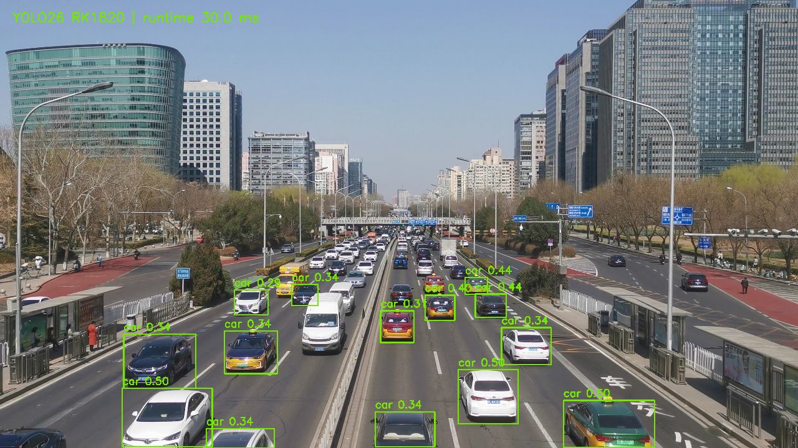

# YOLO26 · RK1820 PCIe + RK3588

English | [中文](README_zh.md)

Standalone ARM64 Docker application named **`rv182x-rk3588-yolo26:latest`**. It follows the dark Web UI and API conventions of `rk3588_yolov8`: live MJPEG preview, confidence/IoU controls, image/video prediction and offline video analysis/download. Inference runs on the external **RK1820**, with RK3588 handling video and HTTP.

## Prerequisites

RK3588 Linux, a PCIe RK1820 M.2 module and Docker. The image bundles matching RKNN3 1.1.0 runtime libraries, Python Lite wheel, YOLO26n model/weight files and an exact copy of the YOLOv8 sample video. No on-device PyTorch or model conversion is required.

Prepare the host driver and proxy before starting the container:

```bash
cd src/rv182x_rk3588_yolo26
sudo bash scripts/setup_host.sh
```

Matching kernel headers, GCC and Make are needed if the driver is not loaded. The host script does not flash firmware by default. For a matching M.2 module that needs firmware, explicitly use `sudo bash scripts/setup_host.sh --flash-m2` (writes firmware and resets the accelerator). Select another PCIe BDF with `sudo RK182X_DEVICE=<BDF> bash scripts/setup_host.sh`. Continue once it reports **Online / OK**. Driver, firmware, proxy and container runtime must match SDK 1.1.0.

The host script does not install an automatic boot service. Run it again after reboot; rebuild the driver after a kernel upgrade. Container restart alone cannot install a host kernel driver.

## Build and run

From the repository root:

```bash
sudo docker build --platform linux/arm64 \
  -f docker/rv182x-rk3588/yolo26.dockerfile \
  -t rv182x-rk3588-yolo26:latest src/rv182x_rk3588_yolo26

sudo docker run -d --name rv182x-rk3588-yolo26 \
  --privileged --network host --ipc host \
  -v "$(pwd)/src/rv182x_rk3588_yolo26/workspace:/app/workspace" \
  rv182x-rk3588-yolo26:latest
```

Alternatively run `sudo docker compose up -d --build` from the source directory. The SDK uses the host localhost proxy, PCIe DMA and shared memory; retain the shown network, IPC and device access settings.

Open `http://<RK3588_IP>:8000`; `/docs` provides OpenAPI and `/api/health` reports readiness and inference metrics. The default source is `video/test.mp4`, copied from `rk3588_yolov8`. The same sample is listed on the Local Video Analysis tab. Mounted `workspace/` stores uploads and outputs.

Export/import an offline image:

```bash
sudo docker save rv182x-rk3588-yolo26:latest | gzip > rv182x-rk3588-yolo26.tar.gz
gzip -dc rv182x-rk3588-yolo26.tar.gz | sudo docker load
```

## Inputs and API

Replace the default command after the image name with:

- `python web_detection.py --camera_id 1` for `/dev/video1`.
- `python web_detection.py --rtsp rtsp://camera/stream` for RTSP.
- `python web_detection.py --camera_id -1` for API/offline-analysis only.

Also supported: `--model_path`, `--weight_path`, `--class_path`, `--core_mask`, `--video_path` / `--video`, `--host` and `--port`. This image uses OpenCV headless for browser presentation. Camera/RTSP decoding depends on the actual source and FFmpeg; tested scope is recorded in `VALIDATION.md`.

```bash
curl -X POST http://127.0.0.1:8000/api/models/yolo26/predict \
  -F file=@model/bus.jpg -F conf=0.25 -F iou=0.45
curl -X POST http://127.0.0.1:8000/api/models/yolo26/predict \
  -F video=@video/test.mp4 -F timestamp=1
curl -X POST http://127.0.0.1:8000/api/models/yolo26/predict -F realtime=true
```

Video endpoints: `POST /api/video/upload`, `POST /api/video/analyze` (form `filename`), `GET /api/video/status`, `GET /api/video/list`, `GET /api/video/download/{filename}`. Preview endpoints: `/api/video_feed` (MJPEG), `/api/snapshot` (JPEG). Threshold endpoints: `GET /api/config`, `POST /api/config` (JSON `obj_thresh`, `nms_thresh`, range 0–1).

Preview, requests and offline analysis serialize access to one RKNN3 context. Each request keeps its own letterbox transform and thresholds. `runtime_ms` includes Lite inference transfer/synchronization overhead; it is not pure NPU latency. `total_ms` adds pre/postprocessing, excluding queue wait, video decode, JPEG encoding and HTTP transfer.

## Validation and provenance

```bash
sha256sum -c SHA256SUMS
python3 scripts/verify_api.py --url http://127.0.0.1:8000 --video short.mp4
```

The hardware regression verifies COCO bus.jpg predictions, eight concurrent image requests, invalid thresholds, JPEG/MJPEG and optional video timestamp/offline processing. See `VALIDATION.md` for actual results.

YOLO26 uses six box/logit heads, four distance channels per box head, sigmoid class scores and padding 114. YOLOv8 DFL postprocessing is not used. The bundled model is 640×640, COCO 80-class, one RK1820 core, W8A8 with upstream W16A16 subgraphs. Conversion scripts and source information are in `conversion/` and `NOTICE.md`.

The independent RK182x workflow builds and publishes this ARM64 image on main/master pushes. After a successful workflow run, pull and tag it for the included Compose file:

```bash
docker pull ghcr.io/seeed-projects/recomputer-rk-cv/rv182x-rk3588-yolo26:latest
docker tag ghcr.io/seeed-projects/recomputer-rk-cv/rv182x-rk3588-yolo26:latest rv182x-rk3588-yolo26:latest
```

## overlayroot hosts

Docker/containerd snapshot storage must reside on a real writable filesystem, not the overlay root itself. An overlay mount `invalid argument` can indicate this problem. On the tested board, `/var/lib/docker` and `/var/lib/containerd` are bind-mounted from writable ext4 directories `/media/root-rw/docker` and `/media/root-rw/containerd`, with systemd mount units for subsequent boots. A normal ext4 root does not need this step. Moving only Docker data-root does not move containerd image storage; see [Docker data directory configuration](https://docs.docker.com/engine/daemon/#configure-the-data-directory-location).


