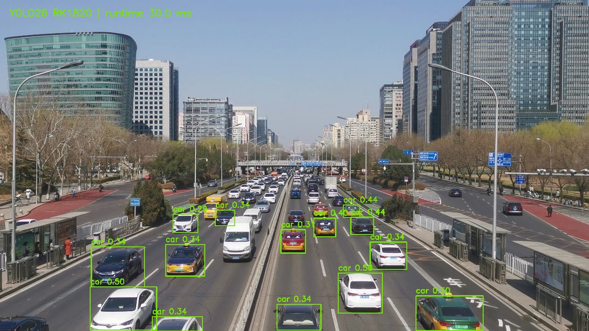

# YOLO26 · RK1820 PCIe + RK3588

[English](README.md) | 中文

独立 Docker 项目，镜像名为 **`rv182x-rk3588-yolo26:latest`**。沿用 `rk3588_yolov8` 的暗色 Web 展示、阈值调节、实时预览和离线视频分析。模型运行在外接 **RK1820**，主控 RK3588 负责视频解码、预处理、后处理和 HTTP 服务。

## 运行前准备

需要 ARM64 RK3588 Linux 主控、PCIe RK1820 M.2 卡及 Docker。镜像包含 RKNN3 **1.1.0** Runtime、Lite Python wheel、已转换的 YOLO26n `.rknn` / `.weight` 和测试视频；不需要在板端安装 PyTorch 或转换工具。

Linux 内核驱动和固件不能用容器代替，必须先在 Host 准备。项目附带 SDK 1.1.0 驱动源码、工具和 M.2 固件：

```bash
cd src/rv182x_rk3588_yolo26
# 如果尚未安装编译工具，请安装 make、gcc 及与 uname -r 匹配的内核头文件。
sudo bash scripts/setup_host.sh
```

这条命令会按需编译并加载驱动、启动代理服务，已有服务不会重复启动。只有实际板型匹配、确实需要刷写时，才显式使用：

```bash
# 写入固件并重置加速卡；仅适用于匹配的 RK1820 M.2 板型。
sudo bash scripts/setup_host.sh --flash-m2
```

默认 PCIe 地址为 `0000:01:00.0`。其他地址可用 `sudo RK182X_DEVICE=<BDF> bash scripts/setup_host.sh` 指定。确认输出 **Online / OK** 后启动容器。Host 端驱动、固件、代理服务应与容器的 1.1.0 Runtime 匹配。Host 脚本尚未安装系统级开机自启；重启后再次执行，内核升级后需重编译驱动。

## 构建与启动

从仓库根目录构建：

```bash
sudo docker build --platform linux/arm64 \
  -f docker/rv182x-rk3588/yolo26.dockerfile \
  -t rv182x-rk3588-yolo26:latest src/rv182x_rk3588_yolo26
```

运行（默认使用从 `rk3588_yolov8` 复制的 `video/test.mp4`）：

```bash
sudo docker run -d --name rv182x-rk3588-yolo26 \
  --privileged --network host --ipc host \
  -v "$(pwd)/src/rv182x_rk3588_yolo26/workspace:/app/workspace" \
  rv182x-rk3588-yolo26:latest
```

也可以进入 `src/rv182x_rk3588_yolo26` 后运行 `sudo docker compose up -d --build`。容器通过 Host 的 localhost 代理服务和 PCIe DMA 访问加速卡，必须保留上述网络/IPC/设备访问设置。

访问 `http://<RK3588_IP>:8000`，API 文档为 `/docs`，健康状态为 `/api/health`。工作目录挂载保存上传视频与分析结果。自带 `test.mp4` 会出现在「Local Video Analysis」页，可直接选择 Analyze。

离线镜像包可用以下命令传递给其他设备：

```bash
sudo docker save rv182x-rk3588-yolo26:latest | gzip > rv182x-rk3588-yolo26.tar.gz
gzip -dc rv182x-rk3588-yolo26.tar.gz | sudo docker load
```

## 输入与 API

命令参数兼容原项目风格：`--model_path`、`--weight_path`、`--class_path`、`--core_mask`、`--video_path`（别名 `--video`）、`--camera_id`、`--rtsp`、`--host`、`--port`。

示例替换容器默认命令：

```bash
# 摄像头 /dev/video1
... rv182x-rk3588-yolo26:latest python web_detection.py --camera_id 1
# RTSP
... rv182x-rk3588-yolo26:latest python web_detection.py --rtsp rtsp://camera/stream
# 只提供图片 API 和离线视频分析，不打开实时源
... rv182x-rk3588-yolo26:latest python web_detection.py --camera_id -1
```

Web 为主要展示方式，此镜像使用 OpenCV headless。摄像头和 RTSP 能否解码取决于实际源与 FFmpeg；本次实测范围见 `VALIDATION.md`。

```bash
curl http://127.0.0.1:8000/api/health
curl -X POST http://127.0.0.1:8000/api/models/yolo26/predict \
  -F file=@model/bus.jpg -F conf=0.25 -F iou=0.45
curl -X POST http://127.0.0.1:8000/api/models/yolo26/predict \
  -F video=@video/test.mp4 -F timestamp=1
curl -X POST http://127.0.0.1:8000/api/models/yolo26/predict -F realtime=true
curl -X POST http://127.0.0.1:8000/api/video/upload -F file=@short.mp4
curl -X POST http://127.0.0.1:8000/api/video/analyze -F filename=short.mp4
curl http://127.0.0.1:8000/api/video/status
```

其他接口：`GET /api/config`、`POST /api/config`（JSON `obj_thresh` / `nms_thresh`）、`GET /api/video/list`、`GET /api/video/download/{filename}`、`GET /api/video_feed`（MJPEG）、`GET /api/snapshot`（JPEG）。阈值范围 0–1，上传文件名不得包含目录。

`runtime_ms` 是 Python Lite inference 调用耗时，包含输入输出同步等开销，不能当成纯 NPU 耗时；`total_ms` 还包含预处理和后处理，不含排队、视频解码、JPEG 编码或 HTTP 传输。预览、API 与离线分析串行共享同一模型，保持坐标和阈值独立。

## 校验与模型来源

```bash
sha256sum -c SHA256SUMS
python3 scripts/verify_api.py --url http://127.0.0.1:8000 --video short.mp4
```

验证脚本检查真实硬件图片检测、8 个并发请求、阈值校验、JPEG/MJPEG，以及可选的短视频指定帧与离线分析下载。

YOLO26 与 YOLOv8 的后处理不同：YOLO26 输出 3 组 box/score，box 为 4 个距离值，score 为 raw logits，需要 sigmoid。预处理 letterbox 使用 padding 114。当前模型为 COCO 80 类、640×640、单核、W8A8 与少量 W16A16 子图混合量化。

转换脚本及来源见 `conversion/` 和 `NOTICE.md`。独立 CI 工作流在 main/master 推送后构建并发布 ARM64 镜像。工作流成功后可拉取并标记为 Compose 使用的本地名称：

```bash
docker pull ghcr.io/seeed-projects/recomputer-rk-cv/rv182x-rk3588-yolo26:latest
docker tag ghcr.io/seeed-projects/recomputer-rk-cv/rv182x-rk3588-yolo26:latest rv182x-rk3588-yolo26:latest
```

## overlayroot 系统

如果 Host 的 `/var/lib/docker` 或 `/var/lib/containerd` 位于 overlay 文件系统，构建可能报 overlay mount `invalid argument`。需要先把这两个目录配置到真实可写 ext4 分区；只迁移 Docker data-root 不会迁移 containerd 的镜像存储。本次验证设备已把它们分别 bind mount 到 `/media/root-rw/docker` 与 `/media/root-rw/containerd`，并配置对应 systemd mount 单元。普通 ext4 根文件系统不需要这个额外步骤。参考：[Docker 数据目录说明](https://docs.docker.com/engine/daemon/#configure-the-data-directory-location)。


