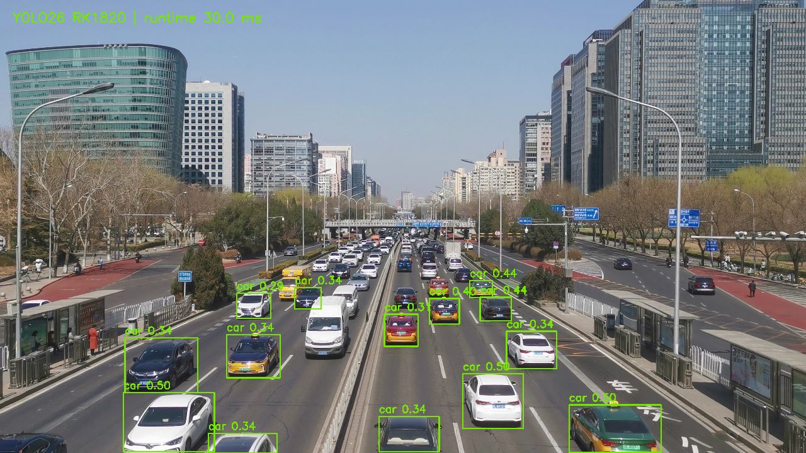

# YOLO26 Docker hardware validation

Date: 2026-11-19 (Asia/Shanghai). Target: reComputer RK3588 / Armbian 26.8.7, kernel 6.1.172-vendor-seeed-rk3588, RK1820 M.2 RM1820MC0-F over PCIe, firmware/runtime 1.1.0. Docker 29.1.3, native ARM64.

Image: `rv182x-rk3588-yolo26:latest`

Image ID: `sha256:2f8627c735ab3dffc082ec70ee37ac96ba04722b1b5095bd5db4eb86d2159fcd`

Export archive SHA256: `30930d0b66e30b76eae37399c621727618cd4132144f123dc5db0e3b965cf6e4`

## Passed

- ARM64 Docker build, Compose launch, Docker healthcheck healthy, zero container restarts.
- Host setup script detects the already-running matching proxy and Online accelerator.
- Bundled bus.jpg: 4 people and 1 bus.
- Eight concurrent image requests return identical predictions while live preview is active.
- Out-of-range configuration and per-request thresholds return HTTP 422.
- JPEG snapshot, MJPEG stream, Web HTML and JavaScript syntax check.
- Uploaded video timestamp prediction.
- 640x360 short-video offline analysis: 100%, no error, output decodes to 30 frames.
- Original copied 4K sample offline analysis: 100%, no error; output retains 3840x2160 and all 394 frames.
- Original 4K video live preview continues across video loops without reported errors.
- Docker save/load succeeds. Archive copied back to the Ubuntu source host and SHA256 matches.
- Bundled binary asset SHA256 checks and Python syntax checks.

The image API sample reported runtime 36.6 ms and total 62.06 ms. These are individual Python API call measurements, not pure NPU latency or a video FPS benchmark. `runtime_ms` includes transfers/synchronization; `total_ms` adds preprocessing and postprocessing, excluding queue wait, decode, JPEG encoding and HTTP.

## Scope

Browser automation failed to connect, so visual layout/interactive clicks were not inspected through a browser. HTML served successfully; JavaScript syntax and the APIs behind the controls were checked. The frame below is a real inference preview, not a browser screenshot. Physical cameras, RTSP sources, RK1828, multiple cards, reboot recovery and GitHub-hosted CI were not tested. No full COCO mAP evaluation was performed.

## Host storage fix

This Armbian installation uses overlayroot. Docker initially failed to mount nested overlay layers. Its new data directories were copied to writable ext4 and bind-mounted from `/media/root-rw/docker` and `/media/root-rw/containerd`, with active/enabled `var-lib-docker.mount` and `var-lib-containerd.mount` units. Host kernel and firmware were not changed during this Docker integration. The previously validated RKNN3 proxy remains running.

## Artifacts

Source host directory: `/home/parker/build/rv182x-rk3588-yolo26/`. It contains the Docker archive, standalone source archive, validation evidence and SHA256SUMS. Local validation preceded publication. Existing local modifications are retained; the existing Docker workflow receives only a path exclusion for this independently built project. GitHub build/publication status is available in repository Actions.

Final image also improves high-resolution label/line readability. API regression and full 4K 394-frame offline processing were rerun successfully after this adjustment.
